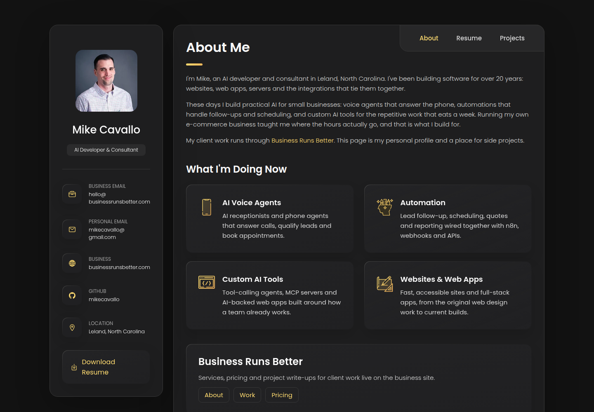
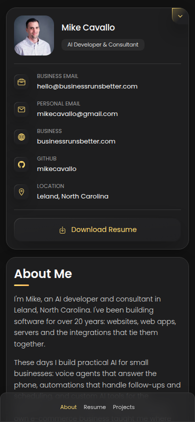

# Mike Cavallo - personal portfolio

A single-page personal vCard for Mike Cavallo, an AI developer and consultant in Leland, North Carolina.
It covers who I am, a short resume, and current projects, and points to
[Business Runs Better](https://businessrunsbetter.com/) for client work, services and pricing.





## What's on the page

- **About**: background (20+ years building software), current focus (AI voice agents, automation,
  custom AI tools) and links to the Business Runs Better About, Work and Pricing pages.
- **Resume**: experience, education and a toolbox of the tools I work with. A PDF resume is linked from the sidebar.
- **Projects**: current AI work (Business Runs Better website, VirtueStage, Jarvis + GPU transcription server,
  RingTask), each labeled with its real status, followed by earlier client websites.

## Tech

Plain static HTML, CSS and vanilla JavaScript. No build step and no dependencies.
Icons come from [Ionicons](https://ionic.io/ionicons) and the font from Google Fonts, both loaded from CDNs.

```
index.html              the whole site
assets/css/style.css    template styles plus a "personal customizations" block at the end
assets/js/script.js     sidebar toggle and tab navigation (supports #about, #resume, #projects)
assets/images/          avatar, icons and project thumbnails (assets/images/projects/)
assets/RESUME.pdf       downloadable resume
scripts/check_links.py  checks local file references, dead "#" links and leftover template text
```

## Run locally

```bash
python3 -m http.server 8000
# open http://localhost:8000
```

Check links before pushing:

```bash
python3 scripts/check_links.py
```

## Deploy (GitHub Pages)

`.github/workflows/pages.yml` runs the link check and publishes the site on every push to `main`.
One-time setup: in the repo go to **Settings > Pages > Build and deployment** and set **Source** to
**GitHub Actions**. The site will then be served at `https://mikecavallo.github.io/personal-portfolio/`.

## Credits and license

Built on the [vCard personal portfolio template](https://github.com/codewithsadee/vcard-personal-portfolio)
by [codewithsadee](https://github.com/codewithsadee), released under the MIT License (see [LICENSE](LICENSE)).
The template code stays under that license. Personal content, the headshot and project screenshots are Mike Cavallo's.
